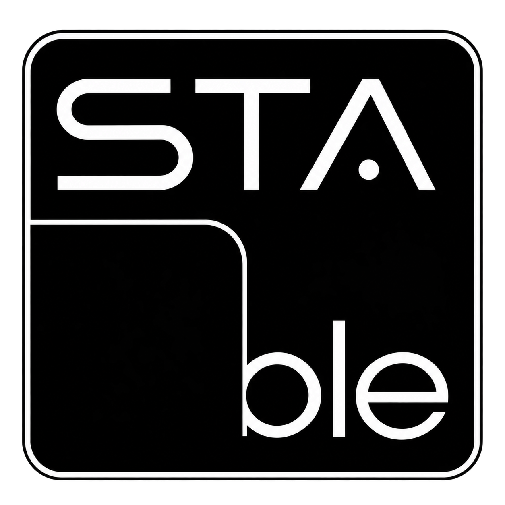
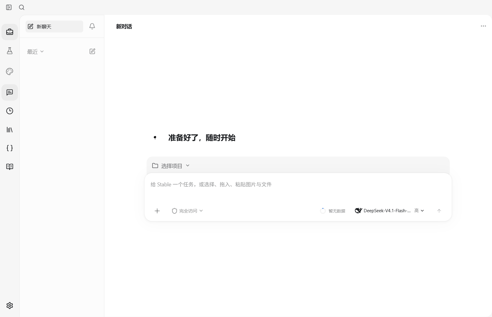

<div align="center">



# Stable

**数据分析 & 数据可视化 Agent**

*让 Agent 读取项目文件、分析 Excel，并把结果交付成可打开、可核对的报告。*

[](https://github.com/LLucas88/Stable/releases/latest)
[](https://github.com/LLucas88/Stable/releases/latest)
[](./LICENSE)
[](https://www.electronjs.org/)

[核心功能](#features) · [快速开始](#quick-start) · [案例演示](#demo) · [系统架构](#architecture) · [开发文档](#documentation)

</div>

---



*Stable Windows 客户端实机截图，展示新建对话界面。*

<a name="why-stable"></a>

## 🎯 为什么用 Stable？

做一份门店周报，往往得打开 Excel、计算周环比、找拖累增长的门店，最后再把图表和结论整理成可分享的文件。Stable 把这些步骤放进同一个桌面项目：你给出数据、分析口径和交付要求，Agent 调用工具处理，结果以文件形式返回。

- **以项目为单位**：把数据表、参考资料和生成的文件放在同一个工作区。
- **以文件为交付物**：在应用内打开报告或表格，核对数据，再把文件带走。
- **把反复做的事留下来**：用 Skills 保存规则，用工作流组织步骤，用定时任务重复运行。

**In English:** Stable is an open-source AI agent for data analysis and visualization on Windows. It analyzes local files and spreadsheets, generates HTML reports, and supports recurring workflows. Its agent runs on the desktop; model inference may use an online service.

<a name="features"></a>

## ✨ 核心功能

| 场景 | 怎么用 | 交付或查看什么 |
| --- | --- | --- |
| Excel 分析与经营复盘 | 添加表格，指定日期、指标、分组和输出格式 | 趋势、门店拆解和可预览的 HTML 报告 |
| 本地文件处理 | 在项目中引用资料，要求 Agent 整理、改写或生成文件 | 工作区中的文件与对话里的产物入口 |
| Skills 与可视化工作流 | 把业务口径保存为技能，把重复步骤串成流程 | 可复用的任务规则与流程 |
| 定时任务 | 为周期性工作设定运行时间 | 任务结果与运行记录 |
| 工具与审批 | 查看执行记录，按任务设置处理需要授权的工具操作 | 已调用的工具、审批及结果 |

本地运行指应用、项目文件与 Agent 执行环境位于 Windows 设备上。在线推理、网页访问和云服务仍需要联网；调用这些服务时，任务所需内容可能发给对应服务。处理敏感文件前，请先检查模型连接与任务权限。

<a name="quick-start"></a>

## 🚀 快速开始

1. 打开 [GitHub Releases](https://github.com/LLucas88/Stable/releases/latest)，在 **Assets** 里下载 **`Stable-Setup-<版本>-x64.exe`**。首次安装用 Setup，不用 Update。
2. 打开 Stable，连接可用的模型服务。例如，在「设置 → 模型连接 → ChatGPT 订阅」授权后，从聊天模型菜单里选择账号可用的模型；也可以使用已有的 Stable Cloud 账号。安装包本身不提供模型额度。
3. 新建项目，添加文件，发出一条带交付要求的任务。完成后，从对话里打开生成的文件。

<a name="demo"></a>

## 📊 案例：从 Excel 到门店经营周报

下载 [示例销售数据（CSV）](./examples/stable-demo-sales.csv?raw=true)，用 Excel 另存为 `.xlsx` 后添加到项目，然后发送：

> 以表内日期为准，对比数据覆盖的最后两个完整自然周（周一至周日）。按门店汇总销售额、订单量和销售额周环比，找出拉动和拖累总销售额的门店。生成一份带每日销售趋势和门店贡献图的单文件 HTML 报告，标注对比日期和缺失数据，不覆盖原始 Excel。图表和样式不要依赖外部资源。

**验收参考。** 样表含 4 家虚构门店、56 条日记录。对比 2026 年 11 月 2–8 日与 11 月 9–15 日，销售额从 **119,210 元**涨到 **123,410 元（+3.52%）**，订单量从 **1,386** 增至 **1,449**。总盘上涨，但 **B 店少了 4,900 元**。以上是按样表核算的对照值，实际报告的措辞和图表会随模型而异。

<a name="architecture"></a>

## 🏗️ 系统架构

```text
React + TypeScript                      对话、项目、预览、工作流
         │ Electron IPC
Electron 主进程                         会话调度、权限审批、定时任务
         ├── SQLite + 项目工作区         会话状态和本地文件
         └── Claude Agent SDK            Agent 执行循环
               ├── 文件 / Excel / 浏览器等工具
               └── 模型适配层 → 已配置的推理服务
```

- **桌面层**负责接收任务、呈现执行过程，并把产物打开给人检查。
- **执行层**负责模型交互和工具调用；Stable 对工具应用当前任务的权限。
- **模型服务**与执行框架是两层。使用 Claude Agent SDK 不等于只能使用 Claude 模型，具体模型和工具能力取决于连接方式及账号。

<a name="documentation"></a>

## 📚 开发文档

- [源码结构](./docs/ARCHITECTURE.md)：前端、Electron 主进程和数据导入模块。
- [ChatGPT 订阅接入](./docs/chatgpt-subscription.md)：授权、模型选择与额度说明。
- [Windows 打包与验证](./.github/workflows/release.yml)：发布流水线和构建依赖。
- [GitHub Releases](https://github.com/LLucas88/Stable/releases) · [历史 README 与开发记录](https://github.com/LLucas88/Stable/blob/71de9af849096a7cf24a4b15fc7f1e621ac481cf/README.md)。

<a name="testing"></a>

## 🧪 从源码运行和测试

在 Windows 上准备 Git 和 Node.js。发布流水线使用 Node.js 24.14.0；打包所需的附加工具和运行时见上方工作流。

```powershell
git clone https://github.com/LLucas88/Stable.git
cd Stable
npm ci
npm run typecheck
npm run build
npm start
```

用 `npm test` 运行仓库测试。类型检查和构建不代替真实 Windows 安装、升级或在线模型验证。

<a name="faq"></a>

## 💬 常见问题

**支持哪些系统？** 公开安装包为 Windows x64。当前 Releases 未提供 macOS 或 Linux 安装包。

**Stable 是 Stable Diffusion 吗？** 不是。这里的 Stable 是 [LLucas88/Stable](https://github.com/LLucas88/Stable)，用于桌面文件处理、数据分析和工作流自动化。

**可以完全离线使用吗？** 应用和工作区在本机；若任务使用在线模型或网页工具，就需要网络。

**模型调用免费吗？** 源码采用 MIT 许可证。模型服务的费用、可用模型和使用额度由所选服务及账号决定。

## 🤝 贡献与反馈

在 [Issues](https://github.com/LLucas88/Stable/issues) 发问题时，请写清 Stable 版本、Windows 版本、复现步骤和预期结果。截图、日志和样表请先脱敏，不要附 API Key、登录令牌或真实经营数据。

## 📄 许可证

Stable 由 [LLucas88](https://github.com/LLucas88) 维护，源码采用 [MIT License](./LICENSE)。第三方组件和模型服务适用各自的条款。

---

<div align="center">

<strong>如果 Stable 帮你少做了一张重复的表，欢迎给项目一颗 ⭐。</strong>

[下载 Windows 版](https://github.com/LLucas88/Stable/releases/latest) · [反馈问题或建议](https://github.com/LLucas88/Stable/issues)

</div>
